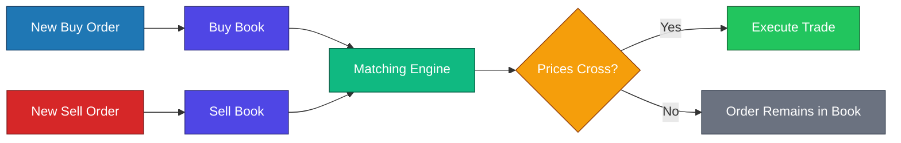

# Limit Order Book Simulator

A simple Java implementation of a **Limit Order Book (LOB)** built to understand how modern exchanges store and match buy and sell orders.

This project focuses on implementing the core matching engine from scratch using Java, object-oriented programming, and priority queues.

---

## Version

**v1.0**

This is the initial version of the project. It is a **terminal-based simulator** that generates random buy and sell orders, stores them in separate order books, and executes trades according to **price-time priority**.

Each order is timestamped using Java's `LocalTime` to preserve the arrival order of orders placed at the same price, simulating the time-priority rule followed by modern exchanges.

The objective of this version is to understand and implement the core matching logic of a limit order book rather than build a complete trading platform.

---

## Features

* Buy and Sell order books
* Random order generation for simulation
* Terminal-based order book visualization
* Price-Time Priority
* Timestamp-based ordering using `java.time.LocalTime`
* Automatic order matching
* Partial order execution
* Complete order execution
* Abstract classes and inheritance
* Java `PriorityQueue` based implementation

---

## Project Goal

The goal of this project is to understand how a stock exchange's matching engine works internally by implementing the core order matching algorithm from scratch.

Topics explored in this project include:

* Data Structures
* Object-Oriented Programming
* Java Collections Framework
* Market Microstructure
* Matching Algorithms

---

## Matching Logic

```text
Highest Buy Price >= Lowest Sell Price
                │
                ▼
        Execute Trade
                │
                ▼
 Reduce Quantities
                │
                ▼
Remove Completed Orders
                │
                ▼
Repeat Until No Match Exists
```

---

## Order Book Flow



---

## Example Order Matching

```text
Initial Order Book

BUY BOOK                    SELL BOOK

104.50  Qty 2               99.20  Qty 3
103.10  Qty 4              101.00  Qty 2

↓

Trade Executed

Quantity = 2

↓

Updated Order Book

BUY BOOK                    SELL BOOK

103.10 Qty 4                99.20 Qty 1
                           101.00 Qty 2
```

---

## Current Limitations

This version is intended as a learning project and does not yet include:

* Market Orders
* Order IDs
* Order Cancellation
* Interactive command-line interface
* Persistent storage
* Price-level based order books (`TreeMap`)
* Performance benchmarking
* Unit tests

---

## Future Improvements

* Add unique Order IDs
* Support order cancellation
* Support market orders
* Interactive command-line interface
* Better order book visualization
* Replace the current implementation with a price-level based order book (`TreeMap<Price, Queue<Order>>`)
* Performance benchmarks
* Unit tests
* Trade history and execution reports

---

## Technologies Used

* Java
* Java Collections Framework
* `PriorityQueue`
* `Comparable`
* `LocalTime`
* Object-Oriented Programming
* Abstract Classes
* Inheritance

---

## Learning Outcomes

This project helped reinforce concepts including:

* Priority Queues
* Custom ordering using `Comparable`
* Abstract classes and inheritance
* Object-oriented design
* Order matching algorithms
* Price-Time Priority
* Partial and complete order execution
* Basic market microstructure concepts

---

## Running the Project

Compile and run the project using Java:

```bash
javac Main.java
java Main
```

The program generates random buy and sell orders, displays the order books, executes trades while matching orders based on price-time priority, and prints the updated order book after each trade.
