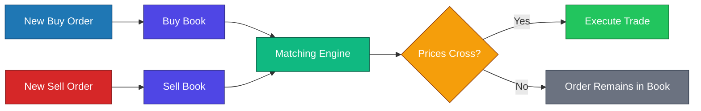

# Limit Order Book Simulator

A simple Java implementation of a **Limit Order Book (LOB)** built to understand how modern exchanges match buy and sell orders.

This project focuses on implementing the core matching engine from scratch using Java and object-oriented programming.

---

## Version

**v1.0**

This version implements the basic order matching algorithm using priority queues.

---

## Features

* Buy and Sell order books
* Price-Time Priority
* Automatic order matching
* Partial order execution
* Complete order execution
* Abstract classes and inheritance
* Java `PriorityQueue` based implementation

---

## Project Goal

The goal of this project is to understand the internal working of a stock exchange matching engine rather than using existing implementations.

It is intended as a learning project covering:

* Data Structures
* Object-Oriented Programming
* Market Microstructure
* Matching Algorithms

---

## Matching Logic

```text
Highest Buy Price >= Lowest Sell Price
                │
                ▼
        Execute Trade
                │
                ▼
 Reduce Quantities
                │
                ▼
Remove Completed Orders
                │
                ▼
Repeat Until No Match Exists
```

---

## Order Book Flow



---

## Order Matching Example

```text
BUY BOOK                    SELL BOOK

104.50  Qty 2               99.20  Qty 3
103.10  Qty 4              101.00  Qty 2

↓

Trade

Executed Quantity = 2

↓

BUY BOOK                    SELL BOOK

103.10 Qty 4                99.20 Qty 1
                           101.00 Qty 2
```

---

## Current Limitations

This version does not include:

* Market Orders
* Order Cancellation
* Order IDs
* Persistent Storage
* Interactive CLI
* Price-Level Data Structures (`TreeMap`)

---

## Future Improvements

* Add Order IDs
* Support Market Orders
* Support Order Cancellation
* Improve Order Book Visualization
* Replace current implementation with a price-level based order book
* Add Unit Tests
* Add Performance Benchmarks

---

## Technologies Used

* Java
* PriorityQueue
* LocalTime
* Object-Oriented Programming
* Abstract Classes
* Inheritance
* Comparable Interface
